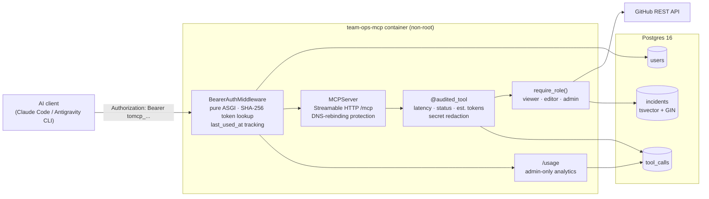

# Team Ops MCP

[](https://github.com/SujahathMSM/teams-ops-mcp/actions/workflows/ci.yml)

An **authenticated, role-based, fully audited [Model Context Protocol](https://modelcontextprotocol.io) server** for engineering-team operations. AI coding assistants such as Claude Code or Antigravity CLI connect to it over Streamable HTTP. From there they can search past incidents and runbooks, read GitHub PRs and issues, and file issues. Every tool call is authenticated, permission-checked, logged to Postgres with secrets redacted, and summarised by an admin analytics endpoint.

> Built as a production-style reference for exposing internal tools to LLM agents **safely**. The tools themselves are simple. The point is the layer around them: identity, least privilege, audit and observability.

---

## Contents

- [Architecture](#architecture)
- [Tools](#tools)
- [Quickstart (Docker)](#quickstart-docker)
- [Connect an AI client](#connect-an-ai-client)
- [Demo](#demo)
- [Security model](#security-model)
- [Observability](#observability)
- [User and token management](#user-and-token-management)
- [Development](#development)
- [Testing and CI](#testing-and-ci)
- [Design decisions](#design-decisions)
- [Project layout](#project-layout)
- [Limitations and next steps](#limitations-and-next-steps)

---

## Architecture



**Request lifecycle**

1. The client sends a JSON-RPC request to `POST /mcp` with `Authorization: Bearer tomcp_...`.
2. `BearerAuthMiddleware` hashes the token and looks the user up by `token_hash`. Missing, invalid and deactivated tokens get `401` before any MCP code runs. The authenticated user is bound to a `ContextVar` for the rest of the request.
3. The MCP SDK checks the `Host`/`Origin` headers (DNS-rebinding protection) and dispatches to the tool.
4. `@audited_tool` starts a timer. Write tools call `require_role(...)` first.
5. Whatever the outcome (`ok`, `error` or `denied`), a row is written to `tool_calls` with redacted arguments, latency and an estimated token count.
6. Admins read aggregated metrics from `GET /usage?days=N`.

---

## Tools

| Tool | What it does | Backend | Required role |
|---|---|---|---|
| `ping` | Health-check tool. Echoes a message with the server UTC time | n/a | any authenticated user |
| `incidents_search` | Full-text search over past incidents and runbooks, ranked by relevance | Postgres FTS (`websearch_to_tsquery`, weighted `tsvector`, GIN index) | any authenticated user |
| `github_open_prs` | Open PRs for `owner/name`, newest first, with author, age, timestamps and requested reviewers | GitHub REST | any authenticated user |
| `github_issue_summary` | Issue counts by state and label (PRs excluded, optional label filter, capped at 300 items) | GitHub REST | any authenticated user |
| `create_issue` | Creates a GitHub issue | GitHub REST (needs `GITHUB_TOKEN`) | **editor** or **admin** |

HTTP endpoints:

| Endpoint | Auth | Purpose |
|---|---|---|
| `POST /mcp` | Bearer | MCP Streamable HTTP transport |
| `GET /health` | public | Liveness check for Docker, CI and humans |
| `GET /usage?days=N` | Bearer, **admin** | Usage analytics over the last N days (1–365) |

The database is seeded with 20 realistic incidents (`INC-1001` … `INC-1020`). They cover connection-pool exhaustion, Redis eviction storms, deadlocks, TLS expiry, Kafka lag and similar problems, each with a root cause and runbook steps.

---

## Quickstart (Docker)

**Prerequisites:** Docker Desktop (or Docker Engine with Compose v2).

```bash
git clone https://github.com/SujahathMSM/teams-ops-mcp.git
cd teams-ops-mcp

cp .env.example .env          # PowerShell: Copy-Item .env.example .env
# Optional: set GITHUB_TOKEN in .env (higher rate limits; required for create_issue)

docker compose up -d --build
curl http://127.0.0.1:8000/health
# {"status":"ok","service":"team-ops-mcp","env":"production"}
```

Create users. Each command prints a token **once**. Only its SHA-256 hash is stored.

```bash
docker compose exec app python -m app.cli create-user alice viewer
docker compose exec app python -m app.cli create-user bob editor
docker compose exec app python -m app.cli create-user admin admin
```

Both ports are bound to `127.0.0.1`, so neither the API nor Postgres is reachable from your LAN.

> **Upgrading an existing database volume?** `sql/schema.sql` only runs on a fresh volume. Apply new migrations with:
> ```bash
> docker compose exec db psql -U teamops -d teamops -f /migrations/001_users_last_used_at.sql
> ```

---

## Connect an AI client

Templates live in [`examples/`](examples/). Never commit a real token. `.gemini/`, `.agents/`, `.claude/` and `.mcp.json` are git-ignored for that reason.

### Claude Code

```bash
claude mcp add --transport http team-ops http://127.0.0.1:8000/mcp \
  --header "Authorization: Bearer tomcp_YOUR_TOKEN"
claude mcp list        # team-ops: http://127.0.0.1:8000/mcp (HTTP) - ✔ Connected
```

### Antigravity CLI (`agy`)

Add the server to the global config `~/.gemini/config/mcp_config.json`. Don't use the workspace file, which would put the token inside the repo. Template: [`examples/antigravity-cli.mcp_config.json.example`](examples/antigravity-cli.mcp_config.json.example).

```json
{
  "mcpServers": {
    "team-ops": {
      "serverUrl": "http://127.0.0.1:8000/mcp",
      "headers": { "Authorization": "Bearer tomcp_YOUR_TOKEN" }
    }
  }
}
```

### Gemini CLI (paid API key only)

Google sign-in for Gemini CLI was retired for individual accounts in June 2026. If you use Gemini CLI with a paid API key, see [`examples/gemini-cli.settings.json.example`](examples/gemini-cli.settings.json.example).

---

## Demo

These are real prompts in Claude Code, connected as `alice` (viewer):

**1. Incident search (Postgres FTS)**
> *Search our team incidents for postgres deadlock and give me the runbook steps.*

The assistant calls `incidents_search` and finds **INC-1008**, a SEV1 deadlock on the `inventory-service` reservation table during a flash sale (SQLSTATE `40P01`). It then summarises the runbook: inspect the `ShareLock` wait chain in the Postgres logs, sort `sku_ids` before `SELECT … FOR UPDATE`, and retry `40P01` up to 3 times.

**2. GitHub read**
> *Use team-ops to check open pull requests in encode/httpx and list the 3 most recent ones.*

The assistant calls `github_open_prs` and lists the newest three PRs with title, author and age in days.

**3. RBAC denial through a real AI client**
> *Use team-ops to create a GitHub issue in SujahathMSM/teams-ops-mcp titled "Test from AI client".*

The assistant calls `create_issue` and the server refuses:

```
Permission denied: tool 'create_issue' requires role 'editor' or 'admin' (user 'alice' has role 'viewer').
```

The assistant then explains that alice only has read access.

All three calls are in the audit log:

```
 id |    tool_name     | status | latency_ms | est_tokens
----+------------------+--------+------------+------------
  7 | create_issue     | denied |          0 |          0
  6 | github_open_prs  | ok     |       3343 |       2534
  5 | incidents_search | ok     |        108 |        210
```

---

## Security model

| Control | Implementation |
|---|---|
| **Authentication** | Random 256-bit Bearer tokens (`tomcp_` + `secrets.token_urlsafe(32)`). Only the SHA-256 hash is stored, so a database leak does not expose usable tokens. Tokens are printed once at creation. |
| **Revocation** | `deactivate-user` takes effect on the next request. `create-user --rotate` issues a new token and invalidates the old one. |
| **Authorization (RBAC)** | `viewer` can use read tools. `editor` can also use write tools. `admin` can do everything and read `/usage`. Checked inside the tool via `require_role()`, so the denial is also audited. |
| **Audit trail** | Every call is logged with user, tool, arguments, status, latency and estimated tokens, whether it succeeded, failed or was denied. |
| **Secret redaction** | Argument keys that look sensitive (`token`, `password`, `api_key`, `authorization`, …) and values matching token patterns (`tomcp_…`, `ghp_…`, `github_pat_…`, `Bearer …`) are replaced with `[REDACTED]` before they are written. |
| **Transport hardening** | MCP SDK DNS-rebinding protection with explicit `allowed_hosts` and `allowed_origins`. Compose binds ports to `127.0.0.1` only. |
| **Input validation** | `owner/name` regex for repos. Bounded `limit` and `days`. LIKE wildcards in search input are escaped. All SQL is parameterised. |
| **Container** | `python:3.12-slim`, runs as a non-root `appuser`, has a Docker `HEALTHCHECK`, and keeps tests, `.git` and `.env` out of the image. |

### A note on agent security

RBAC on an MCP server only governs **that server's tools**. During testing, after `create_issue` was denied, the assistant offered to create the issue with the local `gh` CLI, which uses the developer's own GitHub credentials and goes around the server entirely. Server-side RBAC is necessary but not sufficient. Real least privilege also means limiting which credentials and shell tools the agent's environment can reach.

---

## Observability

Example response from `GET /usage?days=1` with an admin token (trimmed):

```json
{
  "window_days": 1,
  "total_calls": 3,
  "ok_calls": 2,
  "error_calls": 0,
  "denied_count": 1,
  "error_rate": 0.0,
  "avg_latency_ms": 1150.33,
  "total_est_tokens": 2744,
  "by_user": [
    { "username": "alice", "role": "viewer", "last_used_at": "2026-11-20T14:27:08+00:00",
      "total_calls": 3, "ok_calls": 2, "error_calls": 0, "denied_count": 1,
      "avg_latency_ms": 1150.33, "total_est_tokens": 2744 }
  ],
  "by_tool": [
    { "tool_name": "create_issue", "total_calls": 1, "ok_calls": 0, "denied_count": 1, "avg_latency_ms": 0.0, "total_est_tokens": 0 },
    { "tool_name": "github_open_prs", "total_calls": 1, "ok_calls": 1, "avg_latency_ms": 3343.0, "total_est_tokens": 2534 },
    { "tool_name": "incidents_search", "total_calls": 1, "ok_calls": 1, "avg_latency_ms": 108.0, "total_est_tokens": 210 }
  ]
}
```

- `est_tokens` = response characters ÷ 4. It's a cheap estimate of how much context each tool adds to the model's window. Here `github_open_prs` costs about 12× more context than `incidents_search`.
- `last_used_at` is updated at most once per minute per user, which makes stale tokens easy to spot.
- `tool_calls` is indexed on `created_at`, `user_id` and `tool_name` for these queries.

---

## User and token management

```bash
# Inside Docker
docker compose exec app python -m app.cli create-user <username> <viewer|editor|admin> [--rotate]
docker compose exec app python -m app.cli deactivate-user <username>
docker compose exec app python -m app.cli list-users
```

Example output:

```
ID   USERNAME   ROLE     ACTIVE   HASH_PREFIX    CREATED_AT                 LAST_USED_AT
1    alice      viewer   True     954570004ae8   2026-11-20T09:01:12+00:00  2026-11-20T14:27:08+00:00
2    admin      admin    True     cff7301c3d21   2026-11-20T09:01:20+00:00  never
```

- `--rotate` on an existing user issues a new token, updates the role and re-activates the user.
- `deactivate-user` revokes access but keeps the user's audit history.

---

## Development

Requires Python 3.11+ and a Postgres 16 instance. The easiest way is to run just the database from Compose.

```bash
docker compose up -d db
python -m venv .venv
source .venv/bin/activate            # PowerShell: .\.venv\Scripts\Activate.ps1
pip install -e ".[dev]"
cp .env.example .env
python -m app.server                 # http://127.0.0.1:8000/mcp, auto-reload in development
```

Windows note: psycopg3's async driver needs a `SelectorEventLoop`. `app.db.configure_windows_event_loop()` sets it up for the server, the CLI and pytest.

Configuration is read from environment variables or `.env` (see [`.env.example`](.env.example)):

| Variable | Default | Purpose |
|---|---|---|
| `DATABASE_URL` | `postgresql://teamops:…@127.0.0.1:5432/teamops` | Postgres connection |
| `GITHUB_TOKEN` | empty | GitHub PAT. Optional for reads, required for `create_issue` |
| `ALLOWED_HOSTS` / `ALLOWED_ORIGINS` | localhost variants | DNS-rebinding allow-lists (JSON arrays) |
| `APP_ENV` | `development` | `development` enables uvicorn auto-reload |
| `LOG_LEVEL` | `INFO` | Python log level |

---

## Testing and CI

```bash
ruff check . && ruff format --check .
pytest -v --cov=app --cov-report=term-missing
```

- **Unit and integration tests (28):** pytest with an isolated `*_test` database that is created and seeded automatically. GitHub is mocked with `respx`, and the ASGI app is driven in-process with `httpx.ASGITransport`. Coverage includes token hashing, 401 paths, inactive users, RBAC, audit rows for ok/denied/error, secret redaction, FTS ranking, LIKE escaping, `/usage` windows and maths, `last_used_at` throttling and the CLI.
- **End-to-end smoke test:** [`scripts/smoke_test.py`](scripts/smoke_test.py) drives a running server over real HTTP with raw JSON-RPC. It runs the MCP handshake, `tools/list`, tool calls and an RBAC denial, then checks that the audit shows up in `/usage`.

  ```bash
  python scripts/smoke_test.py --viewer-token tomcp_... --admin-token tomcp_...
  ```

- **GitHub Actions** ([`ci.yml`](.github/workflows/ci.yml)) has two jobs:
  1. `lint-test-build`: ruff, pytest with coverage against a Postgres service container, and a Docker image build.
  2. `e2e`: `docker compose up --wait` on the full stack, mints CI tokens with the CLI (masked in logs), runs the smoke test, and dumps container logs on failure.

---

## Design decisions

- **Pure ASGI auth middleware instead of `BaseHTTPMiddleware`.** Starlette's `BaseHTTPMiddleware` buffers response bodies, which breaks streaming transports such as MCP Streamable HTTP. A small ASGI callable avoids that.
- **RBAC inside the tool, not in the middleware.** Every tool shares one `/mcp` endpoint, so the middleware can't tell which tool is being called without parsing JSON-RPC. Checking in the tool also means `@audited_tool` records the denial with full context.
- **Postgres full-text search instead of a vector database.** Incident lookups are dominated by exact terms such as error codes (`40P01`, `502`), service names and incident keys, where lexical search is precise and explainable. A weighted `tsvector` (key/title > service/summary > root cause/runbook) plus a GIN index does this with no extra infrastructure. ILIKE fallbacks catch exact keys and partial names.
- **Hashed tokens instead of JWTs.** For a small internal tool, opaque tokens with server-side lookup give instant revocation and no key management. The cost of one indexed lookup per request is acceptable.
- **Audit logging that never breaks a tool call.** Audit inserts and `last_used_at` updates catch and log their own failures. Observability must not reduce availability.
- **A token estimate in the audit log.** Tool output goes straight into the LLM's context window. Tracking it per tool shows which tools are expensive (here, PR listings) and where to trim payloads.
- **Bounded GitHub calls.** PR listings are capped at 50 and issue summaries at 3 pages / 300 items (with a `truncated` flag), which keeps latency and rate-limit usage predictable for an agent that might call a tool repeatedly.

---

## Project layout

```
app/
  server.py          MCPServer, tool registration, /health, /usage, ASGI app factory
  auth.py            token generation/hashing, Bearer middleware, RBAC, last_used_at
  logging_db.py      @audited_tool decorator, secret redaction, tool_calls writer
  usage.py           /usage aggregation queries
  cli.py             create-user / deactivate-user / list-users
  config.py          pydantic-settings configuration
  db.py              async psycopg pool, Windows event-loop fix
  tools/
    github.py        github_open_prs, github_issue_summary, create_issue
    incidents.py     incidents_search (Postgres FTS)
sql/
  schema.sql         tables, generated tsvector, indexes
  seed.sql           20 sample incidents
  migrations/        idempotent upgrades for existing volumes
scripts/
  smoke_test.py      end-to-end test against a running server
tests/               pytest suite (isolated test DB, respx mocks)
examples/            MCP client config templates (no real tokens)
```

---

## Limitations and next steps

- **Single-tenant, static roles.** There is no per-repository permission scoping yet. Every editor can write to any repo that `GITHUB_TOKEN` can reach.
- **Shared GitHub identity.** Every write is made as the server's `GITHUB_TOKEN`, so GitHub's own audit log can't tell users apart. Per-user GitHub OAuth would fix that.
- **No rate limiting** per user or tool yet. `tool_calls` already has the data needed to enforce quotas.
- **Token expiry.** Tokens are valid until rotated or deactivated. An `expires_at` column would be a small next step.
- **OAuth 2.1 for MCP.** The MCP spec defines an OAuth-based authorization flow. Static Bearer tokens are simpler for internal use but don't support interactive consent.

---

Built by [Sujahath](https://github.com/SujahathMSM).
